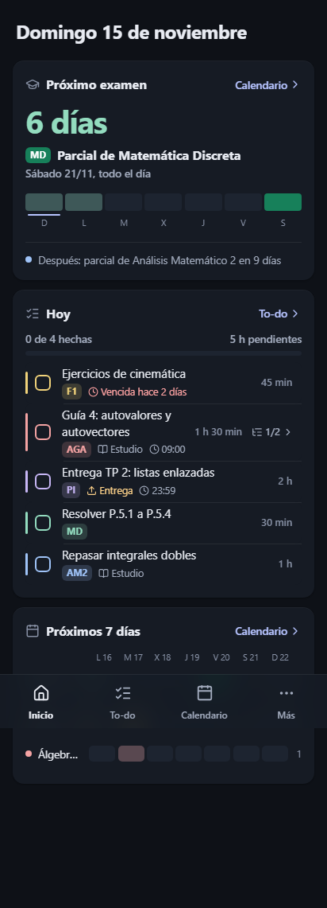
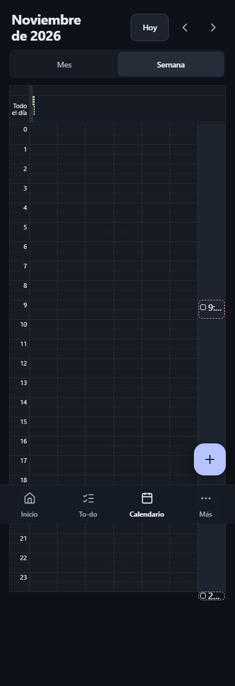
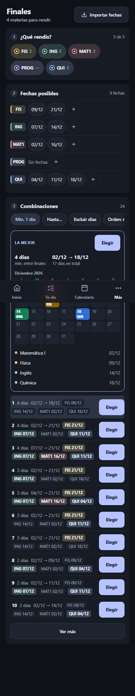
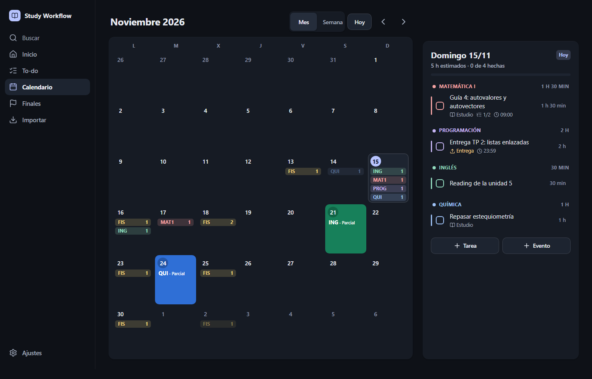
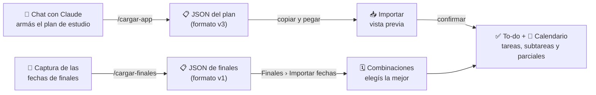

# Study Workflow

**Tu facultad y tu día en una sola app, con el plan de estudio armado junto a Claude.**

To-do, calendario, materias, parciales y finales, en la compu (navegador) y en el celu (APK de Android con widget). Podés usarla **sin servidor**, sincronizando con tu propio Google Drive, o **self-hosted**: en tu propio server con Docker, accesible solo por Tailscale. Sin cuentas propias, sin costos.

<p align="center">
  
  
  
</p>

<p align="center">
  
</p>

> Las capturas usan datos de ejemplo. Hay más (vacío, cargando, error, tema claro) en [`docs/capturas/`](docs/capturas/).

## La idea

Los planes de estudio los armo charlando con Claude: qué ejercicios hago cada día, cuándo repaso, cuándo es el parcial. Pasarlo a mano a un calendario es tedioso, así que una **skill de Claude** convierte el plan acordado a un JSON, y la app lo importa con una vista previa antes de guardar.



- **`/cargar-app`**: toma el plan aprobado en el chat y arma un ítem por bloque de trabajo, con categoría, duración estimada y subtareas (una por ejercicio). Incluye parciales, recuperatorios y finales con fecha confirmada. Formato: [`docs/formato-importacion.md`](docs/formato-importacion.md).
- **`/cargar-finales`**: lee la captura con las fechas de finales que publica la facultad y arma las fechas posibles por materia. En la app elegís qué rendís y te muestra las combinaciones ordenadas. Formato: [`docs/formato-finales.md`](docs/formato-finales.md).

En el celu, el JSON también se puede mandar con **Compartir → Study Workflow** desde la app de Claude.

## Funciones

- **To-do**: vistas Hoy, Próximas, Sin fecha, Por materia y Completadas. Cada tarea lleva fecha y hora, materia, categoría (tarea, entrega o estudio) y duración estimada. El tiempo pendiente se suma por día y por materia.
- **Subtareas**: una tarea puede tener una lista de pasos (por ejemplo, un ejercicio por subtarea). Se ve el progreso (`2/4`) y tildarlas todas completa la principal.
- **Calendario**: vista Mes con chips por materia y exámenes en color sólido, y vista Semana con grilla horaria (3 días en el celu, 7 en la compu). Eventos, parciales, recuperatorios y finales, con repetición semanal.
- **Finales**: cargás las fechas posibles de cada materia (a mano o con `/cargar-finales`) y la app arma las combinaciones con filtros y orden. Elegir una crea los eventos en el calendario, y se puede deshacer.
- **Recordatorios**: tareas y eventos suenan en el celu a la hora, 15 min, 1 h o 1 día antes, o cuando elijas. En modo "Insistente" suenan hasta que los atiendas. Se programan en nativo (AlarmManager), así que andan con la app cerrada.
- **Widget** de To-do para la pantalla de inicio de Android: se puede scrollear y tildar sin abrir la app.
- **Sin conexión**: el APK guarda la última copia y sin red se puede tildar. Los cambios quedan en cola y se suben solos al volver la conexión.
- Y además: materias con color y sigla, búsqueda global (`/` o Ctrl+K), backup y restauración en un `.json`, tema oscuro, claro o según el sistema, guía de primera vez, y "Deshacer" en vez de pedir confirmación.

## Las skills de Claude

Están en [`skills/`](skills/), en versión genérica, y como `.zip` listos para subir en cada [Release](https://github.com/ElJm4esHD/study-workflow/releases/latest):

| Skill | Qué hace |
|---|---|
| [`cargar-app`](skills/cargar-app/SKILL.md) | Plan de estudio del chat → JSON de importación (v3) |
| [`cargar-finales`](skills/cargar-finales/SKILL.md) | Captura o lista de fechas de finales → JSON de Finales (v1) |

**En claude.ai o la app de escritorio:**

1. Bajá `skill-cargar-app.zip` (o `skill-cargar-finales.zip`) del último Release. También podés comprimir vos la carpeta `skills/cargar-app/`.
2. Andá a **Configuración → Capacidades → Skills**, tocá **Subir skill** y elegí el `.zip`.
3. Activala, y en cualquier chat escribí `/cargar-app` o pedí "cargá el plan a la app".

**En Claude Code:** copiá la carpeta a `~/.claude/skills/` (para todos tus proyectos) o a `.claude/skills/` dentro de un proyecto.

Si cambiás el formato en la app, actualizá la skill también: los formatos son un contrato versionado (`version`), y la app sigue aceptando las versiones anteriores.

## Montarlo en tu server

Necesitás un server con Linux, Docker y Compose, [Tailscale](https://tailscale.com/) en el server y en tus dispositivos, y Node 24 en la compu desde la que deployás.

```bash
cp .env.deploy.example .env.deploy   # completá DEPLOY_HOST, DEPLOY_USER, PORT y HTTPS_PORT
npm install
npm run server-setup                 # una vez: repo en el server, carpetas y datos en /srv/study-workflow
ssh -t tu-usuario@tu-server.tu-tailnet.ts.net sudo tailscale serve --bg --https=8443 http://127.0.0.1:8110
npm run deploy                       # push al server, build, backup de la base, health check y rollback si falla
```

- **`.env.deploy`** es la única fuente del host, el usuario y los puertos, y no se commitea. El contenedor escucha solo en `127.0.0.1`, y `tailscale serve` lo publica con HTTPS **solo dentro de tu tailnet**, sin exposición a internet.
- Antes de cada deploy se hace un backup de la base (`/srv/study-workflow/backups/`).
- **Guía paso a paso** (clave SSH en Windows, permisos, verificación, restore y problemas comunes): [`DEPLOY.md`](DEPLOY.md).

## Usala sin server

La forma más simple: ningún servidor, tus datos en tu propio Google Drive.

- **En la compu:** abrí **<https://ElJm4esHD.github.io/study-workflow/>** (se puede instalar como app y anda sin conexión). La primera vez elegí **Google Drive**.
- **En el celu:** instalá el APK de [Releases](https://github.com/ElJm4esHD/study-workflow/releases/latest) (pasos abajo) y elegí **Google Drive** en la primera pantalla.
- Con la misma cuenta de Google, los dos ven los mismos datos. Los datos van a una **carpeta oculta de tu Drive** que solo usa esta app (permiso `drive.appdata`): la app no ve ningún otro archivo tuyo y nadie más tiene acceso. Más en la [política de privacidad](https://ElJm4esHD.github.io/study-workflow/privacidad.html).
- En la web, Google pide un toque en **Reconectar** cada ~1 hora (límite de Google para el navegador); mientras tanto todo se guarda en el dispositivo. En el celu la sesión se renueva sola.
- Si querés tu propia copia del proyecto de Google (para publicar la tuya), la guía está en [docs/google-cloud.md](docs/google-cloud.md).
- También podés usarla **solo en un dispositivo**, o con **tu propio servidor** (secciones siguientes). Se cambia en Ajustes › Sincronización sin perder datos.

## Instalar en el celu

No hace falta Android Studio: el APK ya compilado está en **[Releases](https://github.com/ElJm4esHD/study-workflow/releases/latest)**. Si vas a usar Google Drive, no necesitás nada más. Si vas a usar tu servidor, tenés que tenerlo andando (sección anterior) y Tailscale instalado y conectado en el celu.

1. **Bajá el APK.** Desde el celu, abrí el [último Release](https://github.com/ElJm4esHD/study-workflow/releases/latest) y tocá `study-workflow-X.Y.Z.apk`. Si Chrome avisa que el archivo puede ser dañino, tocá **Descargar de todas formas**.
2. **Permití instalar apps desconocidas.** Abrí el APK desde la notificación de descarga (o desde **Mis archivos › Descargas**). La primera vez Android dice que no puede instalar apps de esa fuente: tocá **Configuración**, activá **Permitir de esta fuente** y volvé.
3. **Si tenés un Samsung con "Bloqueador automático"** (One UI 6 o más nuevo), Android no te deja instalar nada que no venga de una tienda. Desactivalo en **Ajustes › Seguridad y privacidad › Bloqueador automático**, instalá y volvé a activarlo si querés.
4. **Instalá.** Tocá **Instalar**. Si aparece **Play Protect** ("App no reconocida" o "App bloqueada"), es porque la app no viene de Play Store: tocá **Más detalles › Instalar de todos modos**. Si te ofrece mandarla a analizar, podés tocar **No enviar**.
5. **Primera apertura.** La app pregunta dónde guardar los datos: **Google Drive** (recomendado), **Mi servidor** o **Solo este dispositivo**. La app anda sola desde el primer momento, con los datos en el celu. Para tu servidor, la dirección (`https://tu-server.tu-tailnet.ts.net:PUERTO`, el `DEPLOY_HOST` y el `HTTPS_PORT` de tu `.env.deploy`) viene precargada en el APK de `npm run apk` y esa pantalla no aparece; en el APK público se escribe ahí. Se cambia después en Ajustes › Sincronización.
6. **Widget y recordatorios.** Mantené apretada la pantalla de inicio › **Widgets** › Study Workflow. Para que suenen los recordatorios, aceptá los permisos de notificaciones y de alarmas cuando la app los pida.

**Para actualizar**, bajá el APK nuevo del Release e instalalo encima: tus datos están en el server y no se pierden. Si antes habías compilado la app vos, Android la rechaza porque tiene otra firma. En ese caso desinstalala primero.

### Compilar el APK vos

Si cambiaste el código, o preferís no instalar un APK de otra persona. Necesitás Android Studio, que trae el JDK y el SDK.

```powershell
npm run apk -- --check   # verifica JDK, SDK y llave de firma
npm run apk              # dist/study-workflow.apk con la dirección de tu .env.deploy precargada
npm run apk:public       # dist/study-workflow-X.Y.Z.apk genérico: pide la dirección al abrir
```

- La primera vez crea la llave de firma en `%USERPROFILE%\.study-workflow\`, fuera del repo. **Hacele backup**: sin ella no podés actualizar la app instalada.
- Cómo pasarlo al celu por cable o adb, el widget, los permisos de alarmas y problemas comunes: [`docs/android.md`](docs/android.md). Checklist de prueba: [`docs/checklist-s25.md`](docs/checklist-s25.md).
- Cómo se publica una versión nueva en Releases: [`docs/release.md`](docs/release.md).

## Desarrollo

```bash
npm install
npm run dev          # server en :3000 (solo sincronización, base en ./data/sync.sqlite) + Vite con proxy /api
npm test             # API y lógica de dominio (Vitest)
npm run typecheck
npm run a11y         # axe + Playwright a 412 y 1440 px, tema oscuro y claro: tiene que dar 0 violaciones
npm run capturas     # regenera docs/capturas/ con datos de ejemplo en una base temporal
```

## Stack

| Parte | Tecnología |
|---|---|
| Frontend | React + Vite + TypeScript |
| Backend | Node 24 (TypeScript con type stripping) + Fastify + `node:sqlite` |
| Celu | Capacitor 8 (Android), widget y recordatorios nativos en Kotlin + Jetpack Glance |
| Deploy | Docker Compose en tu server, publicado con `tailscale serve` |

Un solo contenedor sirve la API y la web. No hay login: el acceso ya está limitado a tu tailnet.

## Arquitectura modular

Un núcleo chico (materias, ajustes, inicio, búsqueda y backup) y módulos independientes: `todo`, `calendar`, `finals` e `import`. Agregar una función es crear una carpeta `modules/<id>/` y registrarla en `modules/server.ts` y `modules/web.ts`, sin tocar los demás módulos. Un módulo no lee las tablas de otro: usa su API o su servicio. Cada módulo aporta su búsqueda, sus tarjetas de Inicio y su panel de Ajustes.

Contrato completo y ejemplo: [`docs/modulos.md`](docs/modulos.md).

## Documentación

- [`DEPLOY.md`](DEPLOY.md): primer deploy y pruebas, paso a paso.
- [`docs/android.md`](docs/android.md): APK, widget y recordatorios.
- [`docs/formato-importacion.md`](docs/formato-importacion.md) y [`docs/formato-finales.md`](docs/formato-finales.md): los JSON que generan las skills.
- [`docs/modulos.md`](docs/modulos.md): cómo agregar un módulo.
- [`docs/cambios.md`](docs/cambios.md): qué cambió de uso en cada versión.
- [`docs/superpowers/`](docs/superpowers/): diseños y planes de cada etapa.

## Licencia

Copyright © 2026 Federico Gaubeca Klix.

[GNU Affero General Public License v3.0](LICENSE) (AGPL-3.0). Podés usarlo, modificarlo y compartirlo. Si distribuís una versión modificada, o la ofrecés a otras personas por red, tenés que publicar su código con la misma licencia.
